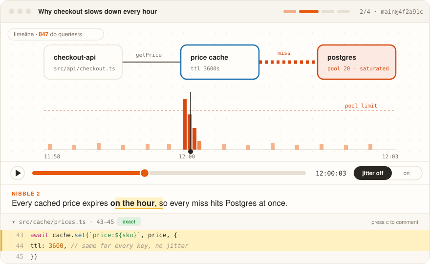
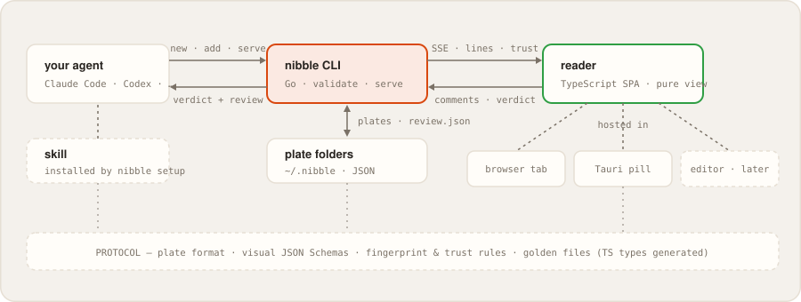

<div align="center">

<picture>
  <source media="(prefers-color-scheme: dark)" srcset="assets/mark-dark.svg">
  
</picture>

**Agent explanations you can poke.**

[](LICENSE)
[](docs/PRD.html)

</div>

<p align="center">

</p>

<p align="center"><i>The agent claims every cached price expires on the hour. You scrub the timeline, watch Postgres saturate at 12:00, flip the fix on, and click any box to see the lines behind it.</i></p>

## Why

Coding agents read and write code faster than anyone can follow. When one
finishes a change, debugs a bug or reviews a PR, it hands you a wall of prose
full of `file:line` references — and you either rebuild the picture in your
head, or type *looks good* and quietly give up your understanding of the
codebase.

Systems are shapes, and behaviours are things that move. nibble makes the agent
explain with an **interactive visual model** of your code, served in small
*nibbles*: one claim, one visual, the evidence a click away. You answer right
on the diagram, and your comments go back pinned to the node, edge, moment or
line you disagreed with.

> *nibble: so you can ruminate.*

## How it works

<p align="center">

</p>

Your agent needs only a shell. It writes a *plate* — a folder of small JSON
files — through the `nibble` CLI, which validates every reference against the
real code and refuses what doesn't exist. Then it blocks on `nibble serve`
until you've read, poked and answered:

```sh
nibble new   --title "PR 1247 · ch 1: payments" --about pr:1247
nibble add   <plate> --caption "…" --visual timeline.json \
             --ref "src/cache/prices.ts:43-45 @cache"
nibble done  <plate>
nibble serve <plate>     # blocks until your review; its exit wakes the agent
```

If the code moves underneath a plate, refs come back as `exact`, `shifted` or
`stale` — never silently wrong.

## Opinions

nibble is opinionated on purpose:

1. **Picture first, prose last.** Captions are one or two sentences, never a paragraph.
2. **Interactive, not animated.** Every visual has something to do: scrub, toggle, step, compare.
3. **One canvas per plate.** Nibbles move a camera across one shared map, not a slideshow.
4. **Code is evidence, on demand.** Click anything to open the validated lines behind it.
5. **Small by default.** Budgets that scale with the task; exceeding them requires a reason, printed on the plate.
6. **Detail is a dial.** Overview / standard / deep — layers on the same canvas, never a longer document.
7. **Review covers the diff *and its shadow*.** The PR map shows changed code, its unvisited dependents, and a ledger of what the plate didn't show you.

## Status

**Design phase** — no code yet. The PRD and mockups are done and the initial
product decisions are settled:

- **[docs/PRD.html](docs/PRD.html)** — the PRD, interactive: step the loop,
  turn the detail dial, filter requirements, read the decision log. Clone and
  open in a browser.
- **[docs/design/mockups.html](docs/design/mockups.html)** — design mockups
  with a live reader demo: scrub the stampede timeline, flip the fix on.

| Component | What it is | Stage |
| --- | --- | --- |
| `cli/` | Single static Go binary: all commands, validation, fingerprints, the local server | v0.1 |
| `reader/` | TypeScript SPA: canvas, visual kinds, detail dial, code drawer — pure presentation | v0.1 |
| `skill/` | What `nibble setup` installs into Claude Code / Codex / Cursor | v0.1 |
| `protocol/` | Plate format, visual JSON Schemas, trust rules, golden files | v0.1 |
| `pill/` | Thin Tauri shell: menu-bar icon + floating pill for waiting plates | v1 |
| editor panel | VS Code / Cursor webview around the same reader | later |

## Prior art

[deck](https://github.com/henit-chobisa/deck) got the agent-side mechanics
right, and nibble keeps them with credit: the agent writes through a shell CLI,
refs are validated at write time, and a blocking command returns your review.
The bet nibble changes is the medium — an explorable model you manipulate,
instead of a guided walk through code.

## License

[Apache-2.0](LICENSE)
